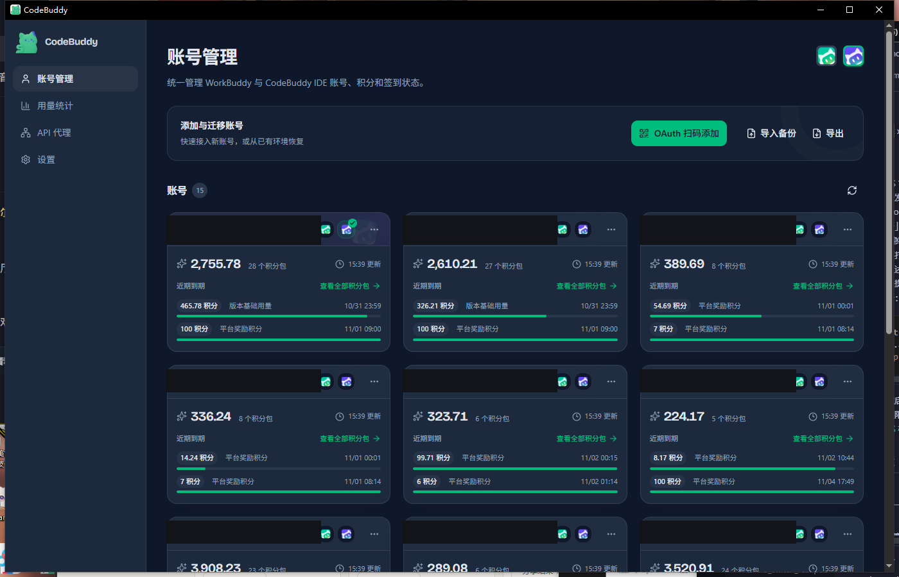

# CodeBuddy

WorkBuddy 与 CodeBuddy IDE 多账号切换桌面 App（Tauri，仅支持 Windows），国内版 / 国际版账号统一管理，提供积分到期监控、Token 用量统计与本地 API 代理中转。

本项目整合了两个开源项目的成果：[changexbc/workbuddy-switch](https://github.com/changexbc/workbuddy-switch)（账号切换、积分监控与统计、Agent 状态悬浮窗）与 [hailinzhao/antigravity-tools](https://github.com/hailinzhao/antigravity-tools)（批量签到、API Key 代理），并在此基础上合并演进为统一的桌面应用。

  

多账号共享登录态，一键切换 WorkBuddy / CodeBuddy IDE 登录账号。**会话复制**：切换账号时可把当前账号的会话以新 id 复制给目标账号，源账号数据不受影响，云端归属目标账号。

## 快速开始

前往 [GitHub Releases](https://github.com/boringstudent/codebuddy-switch/releases/latest) 下载安装包：

| 安装包 | 安装方式 |
| --- | --- |
| `CodeBuddy_<版本>_x64-setup.exe` | NSIS 安装程序，运行后按提示完成安装（推荐） |
| `CodeBuddy_<版本>_x64_en-US.msi` | MSI 安装包，适合批量部署 |
| `CodeBuddy_<版本>_x64-portable.zip` | 绿色便携版，解压后直接运行 `CodeBuddy.exe`，无需安装 |

仅提供 Windows x64 版本；运行依赖系统 WebView2（Windows 10/11 一般已内置，安装程序会自动处理）。

### Android 版本（精简版）

同一套代码的移动端构建：**保留账号管理、API 代理、模型管理、设置（签到等）四个模块**（底部标签栏布局），账号切换、IDE 状态、用量统计、服务站点等桌面专属功能在移动端一律隐藏；代理服务缺省即「开放模式」（监听 `0.0.0.0`，强制子 Key 鉴权），手机可作为局域网其它设备的中转服务器。**后台保活**：代理启动即挂到 Android 前台服务（常驻通知显示端口/模式，`START_STICKY`），并持有 PARTIAL WakeLock 与低延迟 WifiLock——熄屏后 CPU 不休眠、Wi-Fi 不进省电缓冲，后台转发不掉速；停止代理或强杀应用才中断。模型列表在移动端通过「从服务器拉取」（需已添加国内版账号）或「导入目录」获取——桌面端模型管理点「复制目录 JSON」，手机端长按粘贴或选文件导入（含手动单价与实测记录）。移动端不使用剪贴板读取权限：账号备份导入同样为长按粘贴文本框，导出为可长按全选复制的文本。

代理服务对子 Key 客户端额外提供：**余额查询** `GET/POST /credits`（客户端自定义余额 API 兼容，返回 `data.total_usage` = 剩余积分；子 Key 设配额时为配额余量，未设时为可用上游池剩余积分合计）与 **Responses API** `POST /v1/responses`（OpenAI Responses 格式，协议转换到上游 chat/completions，鉴权/选 Key/重试/记账与 chat 链路完全一致）。

- 构建命令：`npm run android:build`（产物为 `src-tauri/gen/android/app/build/outputs/apk/universal/release/app-universal-release.apk`，arm64-v8a 单架构）
- 需要本机具备：JDK 17、Android SDK（platform 35/36、build-tools）、NDK r27c、`aarch64-linux-android` Rust 工具链，环境变量 `JAVA_HOME` / `ANDROID_HOME` / `NDK_HOME`
- 发布签名密钥保存在仓库外的 `C:\Android\keystores\`（`codebuddy-release.keystore` + `codebuddy-signing.properties`），`gen/android/app/build.gradle.kts` 自动读取；该目录不在时构建退回未签名产物，不影响其它机器
- 数据目录：Android 端把核心数据锚到应用私有目录（`/data/data/com.wbswitch.app/files/.wb-switch`），卸载即清除
- 账号备份迁移：移动端「导出」复制 JSON 到剪贴板、「导入备份」支持从剪贴板粘贴，与桌面端导出的 JSON 文件同格式互通

## 功能

| 模块 | 说明 |
| --- | --- |
| 账号管理 | OAuth 扫码登录、导入导出账号备份、删除账号、账号备注 |
| 账号切换 | 一键切换 WorkBuddy / CodeBuddy IDE（国内版 / 国际版）登录账号，切换过程实时显示进度 |
| 会话复制 | 切换账号时可勾选把当前账号的会话复制给目标账号（加法，源账号数据不受影响） |
| 积分到期查询 | 自动查询每个账号的积分剩余量与到期时间；7 天内到期高亮，并按紧迫程度排序、标注「建议优先使用」 |
| 自动签到 | 按签到时间段自动签到；账号页「刷新并签到」同样遵守时间段，未到时间段的账号逐个提示 |
| 派猫猫旅行 | 自动派发猫猫旅行并到点领取奖励 |
| 限额监听 | 通过 hook 实时捕获 429 限额事件，账号卡片秒级更新冷却状态 |
| 用量统计 | 积分统计与 Token 统计合并展示：官方请求用量总览、近 30 天趋势、模型分类、账号消耗与请求明细；Token 总览与趋势、构成占比、活跃热力图、项目/模型 Top 10 与会话排行 |
| API 代理 | 本地 OpenAI 兼容中转服务：账号库一键导入为上游 Key 池，子 API Key 分发与鉴权，专一/临期/轮询/会话亲和四种调用模式，429 冷却与风控自动切换，请求日志自动滚动与 Token/积分统计，积分刷新与状态检测后台逐个处理、表格渐进更新 |

设置 →「支持工具」可分别开关 WorkBuddy 与 CodeBuddy IDE 入口；关闭后该端入口与状态轮询一并隐藏，不影响账号库与其它端。

### 云端账号同步（GitHub Actions 每日签到）

账号库可通过 EO 边缘函数持久化到私有 GitHub 仓库，供仓库内的每日签到工作流（`scripts/daily-checkin.mjs`）拉取与回写。一个函数同时管理四类平台账号：

| 平台 | 账号文件（仓库内） | 凭证字段 | 签到接口 |
| --- | --- | --- | --- |
| CodeBuddy（国内版） | `accounts.json` | `access_token` | `www.codebuddy.cn/v2/billing/meter/*` |
| WorkBuddy（国内版） | `workbuddy-accounts.json` | `credential.access_token` | 同上（WorkBuddy 客户端 UA） |
| Trae CN | `trae-accounts.json` | `cloudIdeJwt` | `api.trae.cn/trae/api/v2/ug/checkin_credits/*` |
| Qoder CN | `qoder-accounts.json` | `credential.access_token` | `openapi.qoder.com.cn/sash/api/v1/me/campaigns*` |

- EO 函数代码在 `edge/eo-account-store.js`，部署步骤与环境变量说明见文件头注释（需要 `ACCESS_KEY` 与有私有仓库 Contents 读写权限的 `GITHUB_TOKEN`）；接口统一用 `?platform=<codebuddy|workbuddy|trae|qoder>` 选择平台，缺省 `codebuddy`；
- 设置 →「云端账号同步」填入函数地址与访问 key，点「上传到云端」把 CodeBuddy 账号库合并推送上去；WorkBuddy / Trae / Qoder 账号用各自客户端导出后，经 `POST /accounts/merge?platform=<name>` 写入（结构保持导出原样，Trae 会补 `id` 供回写）；
- 签到工作流按平台独立拉取、独立签到、独立回写：临期先刷新 token（Trae 无刷新接口），签到结束后把新 token 按 id 合并回对应文件，`refresh_token` 轮换不会导致下次失效；
- 工作流只需仓库 Secrets：`EO_ACCOUNTS_URL`（函数地址）与 `EO_ACCESS_KEY`（访问 key）；可选 `CHECKIN_PLATFORMS`（如 `codebuddy,trae`）限定平台；失败结果会发邮件汇报；
- 改动 EO 函数后可本地验证逻辑：`node scripts/test-eo-account-store.mjs`（内存 mock GitHub API，覆盖鉴权 / 合并 / 回写 / 多平台隔离）。

## 使用

1. **添加与导出账号**：账号页 →「OAuth 扫码添加」「导入备份」；「导出」可将勾选账号备份为 JSON
2. **切换账号与账号信息**：账号卡片 →「切换」，可勾选复制当前会话；「账号信息」可给账号添加备注，并选择卡片上显示账号名 / 手机号 / 备注
3. **查看积分与统计**：账号页自动查询各账号积分到期情况，点「刷新积分」手动更新（并在签到时间段内顺带签到）；侧栏进入「用量统计」查看积分与 Token 用量明细
4. **API 代理**：侧栏进入「API 代理」启动本地中转服务；「从账号导入」把账号库账号加入上游 Key 池，按需创建子 API Key 分发；接口地址 `http://127.0.0.1:<端口>/v1` 兼容 OpenAI 客户端
5. **开关各端入口**：设置 →「支持工具」可分别隐藏 / 恢复 WorkBuddy 与 CodeBuddy IDE 入口
6. **自动签到与旅行**：设置页配置签到时间段与自动签到开关；派猫猫旅行可开关自动派发

## 界面预览

### 账号管理

账号卡片集中展示登录状态、积分余额和到期资源，临期积分直接标注在对应卡片内，并按紧迫程度优先排列（截图中账号信息已打码）。

## 致谢

本项目整合自以下开源项目，感谢原作者的工作：

- [changexbc/workbuddy-switch](https://github.com/changexbc/workbuddy-switch)：WorkBuddy / CodeBuddy 账号切换、积分到期监控、积分统计与 Token 统计、Agent 状态悬浮窗（MIT）
- [hailinzhao/antigravity-tools](https://github.com/hailinzhao/antigravity-tools)：WorkBuddy / CodeBuddy 批量签到与 API Key 代理

## 许可

[MIT](./LICENSE)
